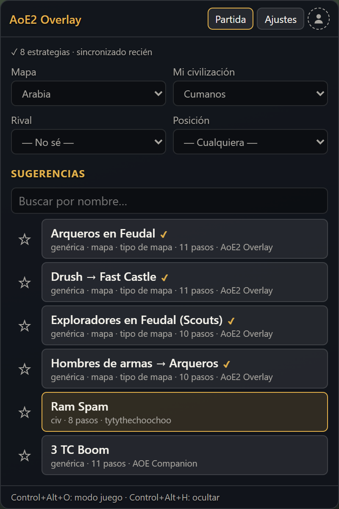
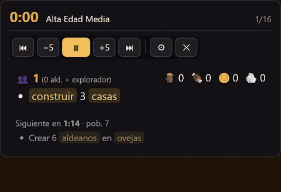
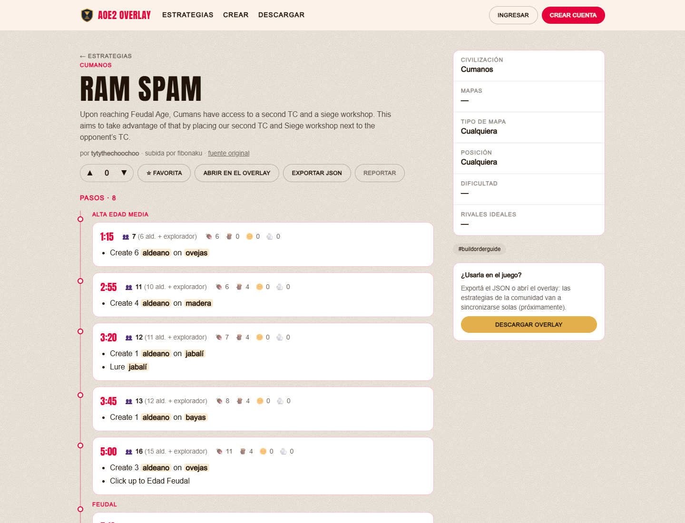

# AoE2 Overlay

Overlay open source de **estrategias de apertura (build orders)** para **Age of Empires II: Definitive Edition**.

- 🪟 **Overlay de escritorio**: muestra los pasos de la estrategia arriba a la derecha, encima del juego. Es transparente y los clics pasan al juego.
- ⏱️ **Reloj sincronizado**: le das _Start_ al empezar la partida y avanza según la velocidad del juego (1.7 por defecto).
- 🗺️ **Sugerencias**: elegís mapa, civilización, rival y posición, y te sugiere estrategias.
- 🌐 **Web y comunidad**: creá, compartí y votá estrategias.

<p align="center">
  <a href="https://github.com/sk8erlucas/aoe2-overlay/releases/latest"></a>
  <a href="https://github.com/sk8erlucas/aoe2-overlay/actions/workflows/ci.yml"></a>
  <a href="LICENSE"></a>
  
</p>

<p align="center">
  
  &nbsp;
  
</p>

<p align="center"><a href="https://youtu.be/B-13galXHyM">▶ Mirá el video demo (40 s)</a></p>

> 🚧 En desarrollo temprano. Mirá el [roadmap](docs/README.md) y los [cambios por versión](CHANGELOG.md).

## Instalación

1. Bajá el instalador desde **[aoe2overlay.sitemaster.com.ar/descargar](https://aoe2overlay.sitemaster.com.ar/descargar)** o desde [Releases](https://github.com/sk8erlucas/aoe2-overlay/releases/latest) (`AoE2.Overlay_*_x64-setup.exe`).
2. Ejecutalo. No pide permisos de administrador. Como el instalador todavía no está firmado, Windows puede mostrar el aviso de SmartScreen: **Más información → Ejecutar de todas formas**.
3. Abrí AoE2 Overlay: aparece arriba a la derecha. Elegí mapa y civilización, tocá una sugerencia y **▶ Jugar**.
4. Al empezar la partida, `Ctrl+Alt+P` arranca el reloj. `Ctrl+Alt+O` cambia entre modo juego (los clics pasan al juego) y modo edición.

Desde la 0.3.1 el overlay se actualiza solo: cuando hay una versión nueva, avisa en **Ajustes**.

## La web

En **[aoe2overlay.sitemaster.com.ar](https://aoe2overlay.sitemaster.com.ar/estrategias)** podés explorar, crear y votar estrategias, marcarlas como favoritas (aparecen primero en el overlay si iniciás sesión) y abrirlas directo en el overlay.

<p align="center">
  
</p>

## Estructura

```
apps/
  overlay/   # App de escritorio (Tauri v2 + React)
  web/       # Sitio web (Next.js 16 + Tailwind 4)
  api/       # Backend (Fastify + Drizzle + PostgreSQL), docs en /api/docs
packages/
  config/    # Configuración compartida (TypeScript, ESLint, Prettier)
  shared/    # Esquema de estrategias, reloj, sugerencias
  game-data/ # Civilizaciones y mapas
strategies/  # Estrategias base en JSON (ver strategies/README.md)
docs/        # Roadmap por fases y arquitectura
```

Más detalles en [docs/arquitectura.md](docs/arquitectura.md).

## Desarrollo local

Requisitos:

- [Node.js](https://nodejs.org) 22 o superior
- [pnpm](https://pnpm.io) (`corepack enable`)
- Para el overlay:
  - [Rust](https://rustup.rs): `winget install Rustlang.Rustup`
  - [Build Tools de Visual Studio](https://visualstudio.microsoft.com/visual-cpp-build-tools/) con la carga de trabajo "Desarrollo para el escritorio con C++"
  - WebView2 (ya viene con Windows 11)

```bash
pnpm install
pnpm lint
pnpm typecheck
pnpm test
pnpm format
```

### Overlay

```bash
pnpm --filter @age-overlay/overlay dev         # app de escritorio con recarga en caliente
pnpm --filter @age-overlay/overlay vite:dev    # solo la UI en el navegador (sin ventana nativa)
pnpm --filter @age-overlay/overlay tauri:build # instalador en apps/overlay/src-tauri/target/release/bundle/
```

El overlay usa la API de producción. Para probar contra una API local, creá `apps/overlay/.env.local` con `VITE_API_URL=http://localhost:3001`.

Atajos por defecto (configurables en _Ajustes_):

| Atajo                          | Acción                                                    |
| ------------------------------ | --------------------------------------------------------- |
| `Ctrl+Alt+O`                   | Modo edición ↔ modo juego (en juego los clics atraviesan) |
| `Ctrl+Alt+P`                   | Iniciar / pausar reloj                                    |
| `Ctrl+Alt+R`                   | Reiniciar reloj                                           |
| `Ctrl+Alt+L` / `Ctrl+Alt+J`    | Adelantar / atrasar 5 s                                   |
| `Ctrl+Alt+PageDown` / `PageUp` | Paso siguiente / anterior                                 |
| `Ctrl+Alt+H`                   | Mostrar / ocultar                                         |

> El overlay es una ventana común "siempre encima": no se inyecta en el juego ni lee su memoria.

## Contribuir

¡Toda ayuda es bienvenida! Leé [CONTRIBUTING.md](CONTRIBUTING.md) y el [Código de Conducta](CODE_OF_CONDUCT.md).

## Firma de código y privacidad

El instalador todavía no está firmado. Cada release publica `SHA256SUMS.txt` para verificar que el archivo descargado es el original. Ver la [política de firma](CODE_SIGNING.md) y la [política de privacidad](https://aoe2overlay.sitemaster.com.ar/privacidad).

## Licencia

[MIT](LICENSE)

## Aviso legal

Age of Empires II © Microsoft Corporation. AoE2 Overlay fue creado según las [Game Content Usage Rules](https://www.xbox.com/en-US/developers/rules) de Microsoft usando assets de Age of Empires II, y no está respaldado ni afiliado con Microsoft.
